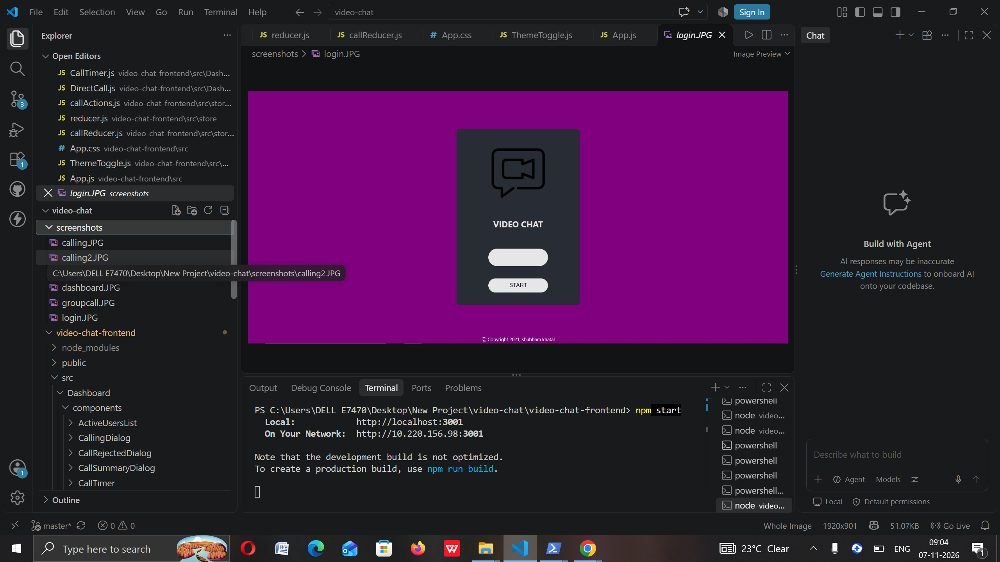
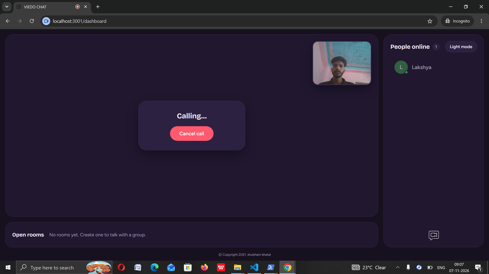
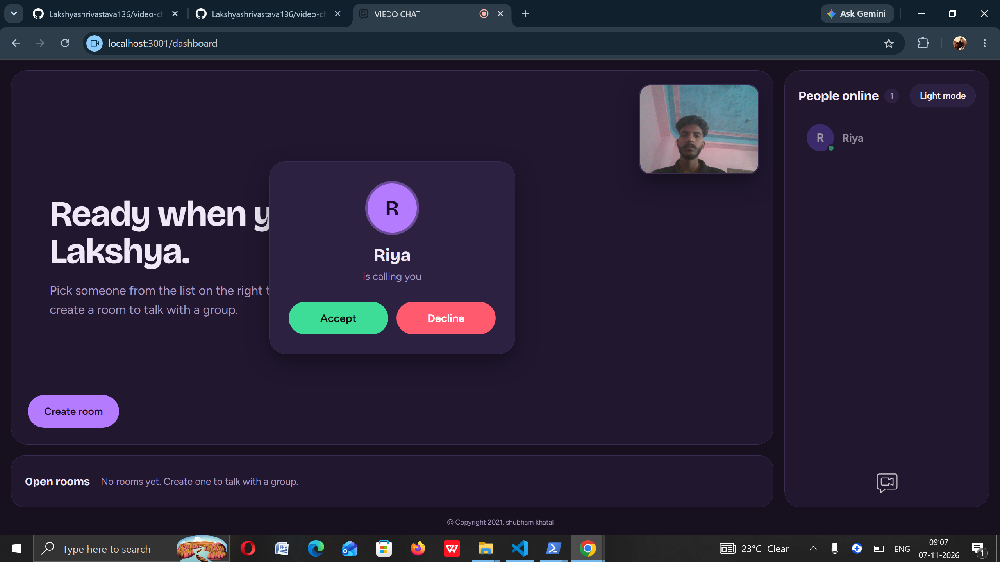
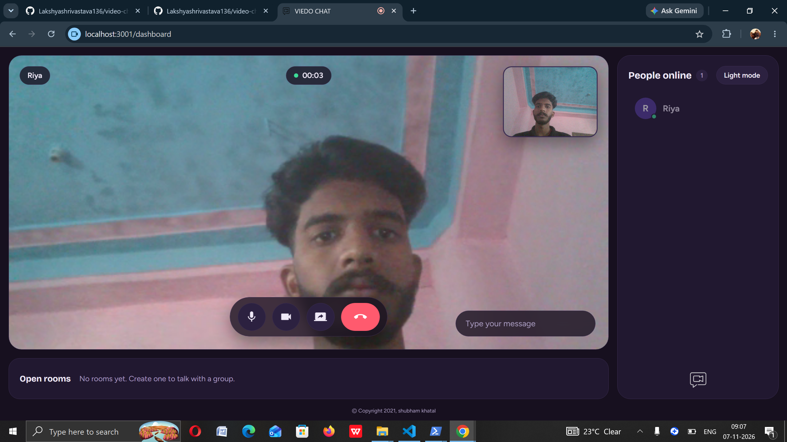

# Video Chat

A real-time video chat app built with React, Node.js, Socket.io and WebRTC (PeerJS).

This is my fork of [shubs70/video-chat](https://github.com/shubs70/video-chat). I used it to learn React, Redux and WebRTC by adding new features and redesigning the UI.

## Screenshots

Login



Calling



Incoming call



In a call



## Features

**Original project**
- Direct one-to-one video calls
- Group video calls (create or join a room)
- Mic mute, camera on/off and screen sharing
- In-call text chat

**Added by me**
- **Call timer**: live call duration during a call
- **Username label**: the other person's name is shown on the call screen
- **Call summary**: after hang up, a box shows who you talked to and for how long
- **Dark and light theme**: toggle button, remembered in the browser
- **New UI**: redesigned login page, dashboard, call controls, dialogs and group room

## Tech stack

- Frontend: React 17, Redux, react-router, socket.io-client, PeerJS
- Backend: Node.js, Express, Socket.io, PeerJS server

## How to run

You need Node.js and Git installed. Run the server and the frontend in two separate terminals.

**1. Server** (http://localhost:5000)

```bash
cd video-chat-server
npm install
npm start
```

**2. Frontend** (http://localhost:3000)

```bash
cd video-chat-frontend
npm install
npm start
```

If you use Node 17 or newer and see `ERR_OSSL_EVP_UNSUPPORTED`, start the frontend like this:

- Windows PowerShell: `$env:NODE_OPTIONS="--openssl-legacy-provider"; npm start`
- Mac / Linux: `NODE_OPTIONS=--openssl-legacy-provider npm start`

The app loads PeerJS from a CDN, so it needs an internet connection.

## How to test a call

1. Open http://localhost:3000 in a normal tab and log in as `user1`.
2. Open an incognito window, open the same address and log in as `user2`.
3. Click `user2` in the list from the `user1` tab, then accept the call in the `user2` window.

## Credits

Original project by [shubs70](https://github.com/shubs70/video-chat).
Added features and redesign by [Lakshyashrivastava136](https://github.com/Lakshyashrivastava136).